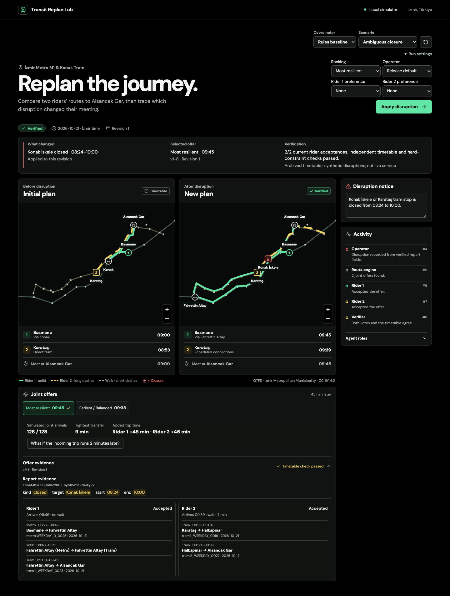
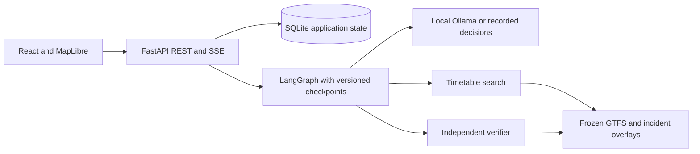

# Transit Replan Lab

Two riders are heading to Alsancak Gar when a simulated report names two
possible tram closures. Transit Replan Lab compares both interpretations on
İzmir's archived timetable and asks which stop is closed. With Konak İskele
confirmed, the earliest meeting is **09:38** and succeeds in **109 of 128**
synthetic delay worlds. The **09:45** alternative succeeds in **128 of 128**.
Each offer exposes the route legs, transfer margin, votes and nominal verifier
result.

[](https://github.com/onurerguden/transit-replan-lab/actions/workflows/ci.yml)



[90-second demo](docs/assets/review-demo.webm) · [Evaluation and reproduction](docs/vnext.md) · [Published v1.1.0 evidence](https://github.com/onurerguden/transit-replan-lab/tree/v1.1.0/experiments/results/vnext)

In the follow-up comparison, the lexicon operator matched the adapted model
on 80 development and 60 calibration notices with zero inference calls.
Both sets contain previously inspected synthetic notices. [Measurements and conditions](docs/review-implementation.md).

## Run the demo

```sh
docker compose up --build --wait
```

Open **http://127.0.0.1:8080**. Apply the ambiguous closure, compare the two
possible outcomes, and select **Konak İskele (Tram)**. Switch between the early
and resilient offers and open **Offer evidence**. Choose **Most resilient**
under **Run settings** to verify the more resilient offer. The default Docker
setup runs offline without an API key or model download. SQLite preserves runs
across restarts.

To use live local inference, pull `qwen3.5:4b-q4_K_M` in Ollama and start the app
with `TRL_MODEL=ollama`. Docker uses `http://host.docker.internal:11434` by
default. Set `OLLAMA_BASE_URL` to override it. The legacy demo is available at
`/?workflow=legacy`.

## Architecture



The route engine preserves train arrivals and terminal walking windows because the earliest arrival can leave one rider waiting too long. LangGraph coordinates role-specific observations, at most two proposal rounds, and a ten-call budget. A plan becomes verified only after two current-version acceptances for the same offer and an independent check of every leg. Durable steps and a monotonic event log support restart and SSE reconnection. [Architecture and tracing](docs/architecture.md) · [API schema](frontend/openapi.json).

## v1.0.0 evaluation

| Coordinator | Correct outcomes on 60 locked cases | p95 |
| --- | ---: | ---: |
| Rules | 55/60 | 0.33 s |
| Single agent | 60/60 | 6.73 s |
| Three agents | 58/60 | 15.52 s |
| Five agents | 60/60 | 10.97 s |

There were zero verified hard-constraint violations in 252 locked comparisons. The rules baseline stayed the default under the development decision rule. In the v1.0.0 evaluation, the model variants handled delay paraphrases that the recorded rules baseline missed. Adding a counteroffer round left success at 10 of 12 cases in the matched ablation. [Protocol](docs/experiment-protocol.md) · [Results and raw rows](experiments/results/REPORT.md) · [Default decision](docs/adr/0005-default-and-notice-grounding.md).

An Operator-only QLoRA experiment improved held-out strict-schema matching from 1/60 to 50/60 in MLX. The fused adapter matched two of four reference outcomes in the Ollama route slice and was not adopted. [Reproduction and data card](finetune/README.md) · [LoRA results](finetune/results/REPORT.md).

## Engineering review

The hardening review documents the reproduced failures, repair plan, and verification for incident grounding, terminal walking windows, and command recovery. [Review and evidence](docs/v1-hardening-review.md).

## Develop and verify

Use Python 3.12, uv 0.11.7, Node 24.21, Corepack 0.36, and Git.

```sh
make setup
make dev
```

Open the Vite URL printed by the command. The backend defaults to port 8000. Set `TRL_MODEL=ollama` before `make dev` to use the Ollama instance at `127.0.0.1:11434`.

```sh
make check
make build
(cd frontend && corepack pnpm exec playwright install chromium)
TRL_MODEL=replay make e2e
uv run --locked --project backend trl route --scenario demo
make experiment EXPERIMENT_ARGS='--split dev'
```

The experiment runs sequentially on local Ollama. The development command above exercises the four coordinators on the 24 development cases. To recreate the published conditions use each split's recorded source commit, a clean results directory, the pinned model digest, and `EXPERIMENT_ARGS='--split dev'` or `EXPERIMENT_ARGS='--split locked'`. See the [phase checklist](docs/roadmap.md) for verification gates.

## Schedule scope

The simulator uses a fixed weekday in the archived Metro M1 and Konak Tram timetable. It includes synthetic disruptions and assumed walking times at the two published interchanges. A route requiring confirmed accessibility excludes unknown stops or connectors. The map connects stop locations from the feeds. Live service, current travel advice, and the rest of the İzmir network are outside this simulation.

Schedule data is attributed to İzmir Metropolitan Municipality under CC BY 4.0. [Archive checksums and attribution](data/gtfs/SOURCES.md). The code is [MIT licensed](LICENSE).
