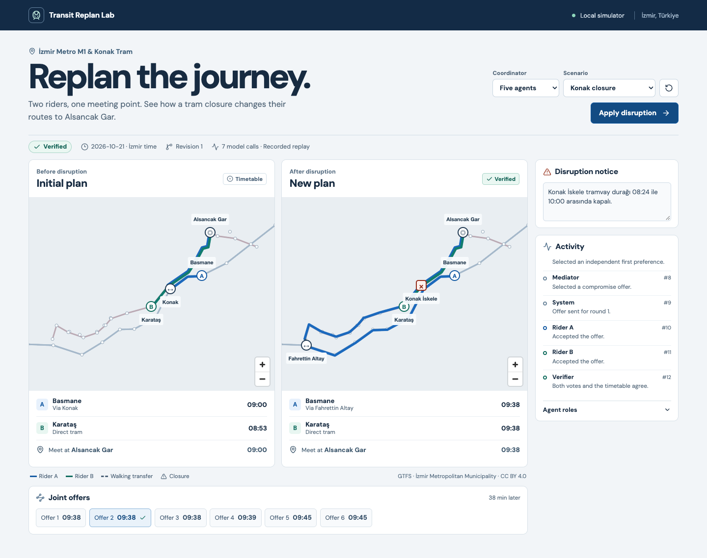
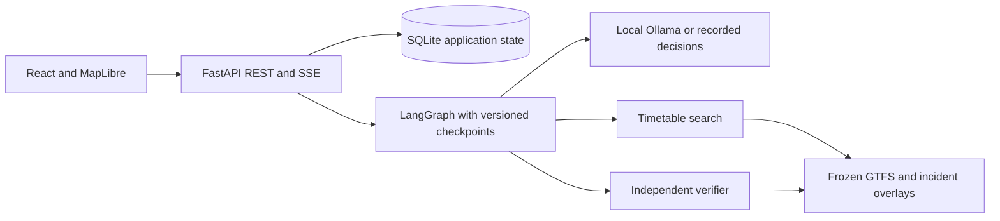

# Transit Replan Lab

Two riders are heading to Alsancak Gar when a simulated closure takes Konak İskele out of their route. Transit Replan Lab rebuilds the trip using İzmir's archived Metro M1 and Konak Tram schedules. The demo changes the interchange to Fahrettin Altay and moves the joint arrival from **09:00 to 09:38**.

[](https://github.com/onurerguden/transit-replan-lab/actions/workflows/ci.yml)



## Run the demo

```sh
docker compose up --build --wait
```

Open **http://127.0.0.1:8080**, apply the Konak closure, and select a joint offer to highlight its route. Choose **Five agents** and set up a new run to inspect the recorded local-model negotiation. Choose **Tight meeting window** to reproduce a completed search with no feasible meeting. The Docker default uses replay and needs no API key or model download. SQLite preserves runs across restarts.

For live local inference, run Ollama and pull `qwen3.5:4b-q4_K_M`. Then start the app with `TRL_MODEL=ollama`. Docker uses `http://host.docker.internal:11434` by default. Set `OLLAMA_BASE_URL` to override it. The API and browser use the same offline timetable and verifier in either mode.

## Architecture



The route engine preserves different arrival times because the earliest train can leave one rider waiting too long. LangGraph coordinates role-specific observations, at most two proposal rounds, and a ten-call budget. A plan becomes verified only after two current-version acceptances for the same offer and an independent check of every leg. Durable steps and a monotonic event log support restart and SSE reconnection. [Architecture and tracing](docs/architecture.md) · [API schema](frontend/openapi.json).

## What the experiments found

| Coordinator | Correct outcomes on 60 locked cases | p95 |
| --- | ---: | ---: |
| Rules | 55/60 | 0.33 s |
| Single agent | 60/60 | 6.73 s |
| Three agents | 58/60 | 15.52 s |
| Five agents | 60/60 | 10.97 s |

There were zero verified hard-constraint violations in 252 locked comparisons. The rules baseline stayed the default under the development decision rule. The model variants understood delay paraphrases outside the rules grammar. Adding a counteroffer round left success at 10 of 12 cases in the matched ablation. [Protocol](docs/experiment-protocol.md) · [Results and raw rows](experiments/results/REPORT.md) · [Default decision](docs/adr/0005-default-and-notice-grounding.md).

An Operator-only QLoRA experiment improved held-out strict-schema matching from 1/60 to 50/60 in MLX. The fused adapter matched two of four reference outcomes in the Ollama route slice and was not adopted. [Reproduction and data card](finetune/README.md) · [LoRA results](finetune/results/REPORT.md).

## Develop and verify

Use Python 3.12, uv 0.11.7, Node 24.21, Corepack 0.36, and Git.

```sh
make setup
make dev
```

Open the Vite URL printed by the command. The backend defaults to port 8000. Set `TRL_MODEL=ollama` before `make dev` to use the Ollama instance at `127.0.0.1:11434`.

```sh
make check
make build
(cd frontend && corepack pnpm exec playwright install chromium)
TRL_MODEL=replay make e2e
uv run --locked --project backend trl route --scenario demo
make experiment
```

The full experiment runs sequentially on local Ollama. To recreate the published conditions use each split's recorded source commit, a clean results directory, the pinned model digest, and `EXPERIMENT_ARGS='--split dev'` or `EXPERIMENT_ARGS='--split locked'`. See the [phase checklist](docs/roadmap.md) for verification gates.

## Schedule scope

The simulator uses a fixed weekday in the archived Metro M1 and Konak Tram timetable. It includes synthetic disruptions and assumed walking times at the two published interchanges. A route requiring confirmed accessibility excludes unknown stops or connectors. The map connects stop locations from the feeds. Live service, current travel advice, and the rest of the İzmir network are outside this simulation.

Schedule data is attributed to İzmir Metropolitan Municipality under CC BY 4.0. [Archive checksums and attribution](data/gtfs/SOURCES.md). The code is [MIT licensed](LICENSE).
