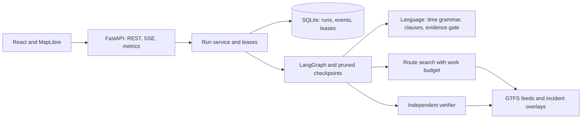

# Transit Replan Lab

Two riders are heading to Alsancak Gar when a report names a closure. Transit Replan Lab reads
the report in Turkish or English, applies only what the text supports, searches the archived
İzmir timetable for a place and time where both riders can meet, and verifies the plan with a
separate checker before it calls it verified. If the report is ambiguous it asks one question.
If it names another day, another time zone or no event, it refuses to guess.

[](https://github.com/onurerguden/transit-replan-lab/actions/workflows/ci.yml)


[90-second demo](docs/assets/review-demo.webm) · [Technical report](docs/v2/technical-report.md) · [Architecture](docs/architecture.md) · [Changelog](CHANGELOG.md)

## Run it

```sh
docker compose up --build --wait
```

Open **http://127.0.0.1:8080**. The default setup runs offline with no API key and no model
download. Apply the ambiguous closure, answer the question, switch between offers and open
**Offer evidence**. A run keeps its address (`?run=…`), so a link reopens it. SQLite keeps runs
across restarts. To read reports with a local model, pull `qwen3.5:4b-q4_K_M` in Ollama and set
`TRL_MODEL=ollama`.

Observability is optional: `docker compose --profile obs up -d` adds Jaeger, Prometheus and a
Grafana dashboard on `localhost:3000`.

## What is measured

Numbers below come from files in this repository and can be regenerated.

**Reading reports (TRL-Bench v3, held-out test split, 1,000 bilingual groups).** The split was
generated from phrase parts that no other split uses, with 8 of 39 stops held out. An audit proves the parts,
stops, texts and masked templates are disjoint, and the test phrases are not in the production
phrase list. Results were read once, after a preregistration was committed.

| Arm | Correct | 95% interval | Unsupported applications |
| --- | ---: | --- | ---: |
| Deterministic rules | 51.4% | [47.0%, 55.7%] | 0 of 2,000 |
| Rules plus phrase list | 51.4% | [47.0%, 55.7%] | 0 of 2,000 |
| Rules plus a gold event quote (ceiling for any model) | 84.1% | [79.7%, 88.3%] | 0 of 2,000 |
| Rules plus a random quote (gate test) | 56.1% | [51.0%, 60.6%] | 0 of 2,000 |

The gold-quote row is not a language model. It shows how much a model can add through the
evidence gate: it supplies the event kind, and every other field is still read by deterministic
parsers from text that the gate has checked. The upper bound on unsupported applications is
0.18% at 95% confidence. [Full report](experiments/results/v2/bench/test.md) · [Preregistration](docs/v2/preregistration.md).

**Language model arms (first 600 test reports, preregistered subset, three training seeds).** A 4B
local model with a LoRA adapter trained on the train split reads 59.5%, 77.7% and 76.8% across
seeds, against 53.7% for rules, the phrase list and the unadapted model, and 96.2% for a gold quote.
No arm applies an unsupported incident. On all 2,000 test reports with the final reader, rules read
53.8% and the seeds 59.6%, 80.3% and 78.5%. On 438 reports rewritten by a model from another family
(label noise from dropped negations is documented), rules read 36.8% and the three seeds 43.8–52.7%.
The seed spread is large, so a single seed would have
misreported the recipe. The adapter is still **not adopted** because the registered adoption rule
could not be met on dev, and the default stays deterministic. [ADR 0016](docs/adr/0016-operator-adapter-v2.md).

**Routing on the whole network (five feeds, 11,857 stops, 2.2 million stop times).** The network
compiles in about five seconds and loads from a cache in 30 ms. With riders starting near a
shared destination, the default fast mode answers 40 queries with 26 meetings, 14 with none and
none incomplete: p50 0.56 s, p95 1.49 s on one process, 5.2 queries per second on four. The exact
mode, which keeps every alternative chain, takes p95 3.2 s and ends 13 of the 40 as an explicit
*search incomplete* outcome. Fast mode keeps the best offer and is checked against the exact
search. [Measurements](docs/adr/0014-compact-timetable-and-bounded-search.md). Runs in the web interface use the core network (Metro M1 and
Konak Tram). `POST /v1/route` answers a stateless meeting query on either network with `TRL_NETWORK=full`.

**Correctness.** 200 deterministic backend tests, 7 interface unit tests and 15 browser tests,
with 90% branch coverage. 27 defects found in review each have a regression. Router and verifier
are checked against an exhaustive journey oracle on random networks.

## How it works



- **A plan is verified only when** two riders accept the same offer in the current revision and
  a verifier that does not import the router passes it. The verifier has its own rule for
  closures: a rider may not wait inside a closed stop.
- **A report is applied only when** its text supports it: one day, the local zone, an event
  clause that is not negated or hedged, and fields that deterministic parsers read from it. A
  model may name the event kind. It cannot add a stop or a time.
- **Runs survive failures.** Commands are idempotent and version-checked, workers hold leases
  with fencing tokens, steps are keyed, model calls run outside transactions, and databases
  upgrade through numbered migrations with a backup. [ADR 0011](docs/adr/0011-lifecycle-leases-and-migrations.md).

## Develop

Use Python 3.12, uv 0.11.7, Node 24, Corepack 0.36 and Git.

```sh
make setup
make check        # lint, types, tests with coverage, import contracts, frontend, public boundary
make build
make e2e          # browser suite
make test-deep    # long property and state-machine suites
python -m experiments.bench_v3 audit
```

`make dev-api` and `make dev-web` start the two servers in separate terminals. The
[roadmap](docs/roadmap.md) lists what each phase delivered and the [implementation
log](docs/v2/implementation-log.md) records what was not done.

## Limits and assumptions

- Reports, incidents and delays are **simulated**. This is not travel advice and it uses no live data.
- ESHOT and İZBAN calendars do not cover the demo day, so their weekly pattern is repeated and labelled as an assumption. İzdeniz publishes no usable archive.
- Walking links between stops are generated (1.2 m/s, detour factor 1.3, 60 s buffer) and have unknown accessibility. The two documented interchanges use an assumed eight minutes.
- The benchmark was generated by the same author as the system, uses 39 stops and raw trip identifiers, and has no independent human annotation. A blind review packet exporter exists for a future reviewer.
- There is no authentication. A run identifier is the only access control.
- Fast mode keeps the best offer but not every alternative chain. Exact mode can end dense full-network queries as incomplete.

## Data and license

Schedule data is attributed to İzmir Metropolitan Municipality under CC BY 4.0. [Archive checksums, health report and attribution](data/gtfs/SOURCES.md). The code is [MIT licensed](LICENSE).
