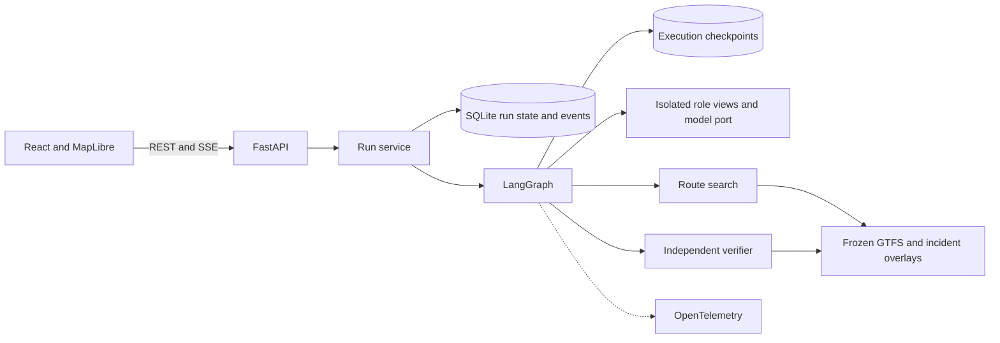

# Architecture

The application owns the current incident version, offers, votes, and status. The graph checkpoint owns execution position. A new incident uses a new thread keyed by run and version. On resume, a node can reuse its committed step by key. A write checks the incident version inside the same SQLite transaction as the corresponding public event. Model calls run outside that transaction.

The router and independent verifier both read the same schedule and incident types. The verifier reconstructs trip legs from the schedule without importing the router. Verification also requires one acceptance per rider for the same current-version offer. Agents receive role-specific projections of state.

## Interface direction

The simulation opens on paired maps with a common geographic extent, clear transfer symbols, and matching stop labels. A compact journey comparison under the maps gives arrival and waiting times. The timeline sits alongside the maps on wide screens and follows them on narrow screens. Clicking an offer highlights its exact legs and retains keyboard focus on the offer. Verification state is written out beside an icon, and a closed stop has a distinct map marker. The map and fonts must work offline.

## Inspect a run

Start Jaeger with `docker compose --profile obs up -d jaeger`. Set `OTEL_EXPORTER_OTLP_ENDPOINT=http://127.0.0.1:4318` for the local API. Find service `transit-replan-lab` in the [Jaeger UI](http://localhost:16686). The local smoke test observed 15 spans for the mediated demo, including seven model spans parented by graph nodes. The JSON run log carries the matching run and trace IDs. The SQLite ledger records reserved attempts, model digest, context, token counts, duration, and schema outcome. Prompts and user notices are excluded from span attributes.

Run the browser and persistence tests with `make check` and `make e2e`. In fault tests, a process is killed after a durable graph node and again during a reserved model call. The resumed work spends another reserved call in the latter case. A late result for a superseded version changes no application data.
