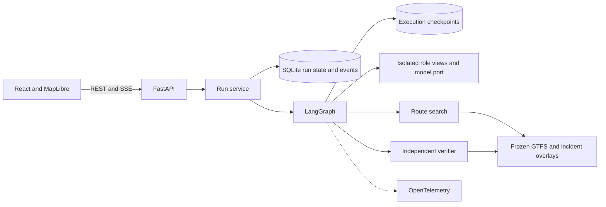

# Architecture

The application owns the current incident version, offers, votes, and status. A table in `trl.lifecycle` lists which status each command may start from and what a worker may write while a run is planning. A worker holds an execution lease for one run revision and every guarded write checks its fencing token in the writing transaction, so a command that moves the token on makes any earlier worker stale. Model calls run outside transactions. The graph checkpoint owns execution position and lives in its own database that is pruned when a revision settles. A new report, retraction or retry opens the next revision.

The router and the independent verifier read the same schedule types but not each other. The verifier derives presence intervals from a finished plan and interprets incidents with its own state, and import contracts forbid it from importing routing or the router's overlay. A plan is verified only after one acceptance per rider for the same current-version offer. Agents receive role-specific projections of state. See [ADR 0010](adr/0010-closure-occupancy-and-independent-verifier.md) and [ADR 0011](adr/0011-lifecycle-leases-and-migrations.md).

Reports pass through `trl.language`: one grammar for dates, zones, durations and clocks, clause-scoped negation, and an evidence gate that accepts a model's event quote only when the text supports it ([ADR 0012](adr/0012-language-grammar-and-evidence-gate.md)). The five official feeds are pinned and checked, and the full network compiles to cached arrays that bound each query before the exact search ([ADR 0013](adr/0013-full-network-feeds-and-assumptions.md), [ADR 0014](adr/0014-compact-timetable-and-bounded-search.md)). Operations are covered in [ADR 0015](adr/0015-operations-and-interface.md).

## Incident and route evidence

The Operator proposes a typed incident. The application compares its fields with the explicit event supported by the notice before it changes the timetable. An ambiguous or conflicting notice produces a clarification. For terminal walks, the route engine intersects feasible arrival windows with the rider wait limits. The independent verifier checks the resulting timestamps against the schedule. [Decision record](adr/0006-incident-evidence-and-walking-windows.md).

## Interface direction

The simulation opens with the disruption, selected offer and verification evidence. Clarification controls precede the paired maps. Both maps use a common extent, transfer symbols and matching stop labels. A compact journey comparison under the maps gives arrival and waiting times. The timeline sits alongside the maps on wide screens and follows them on narrow screens. Clicking an offer highlights its exact legs and retains keyboard focus on the offer. The evidence inspector shows the selected revision, trip IDs and dates, rider votes, destination waits, and the verifier's result. Verification state is written out beside an icon, and a closed stop has a distinct map marker. The map and fonts must work offline.

A dropped command response can be retried with its original request body and idempotency key. The browser streams the activity and reads the outcome when the current revision reaches a terminal event. A failed outcome read has its own retry without an additional mutation.

## Inspect a run

Start Jaeger with `docker compose --profile obs up -d jaeger`. Set `OTEL_EXPORTER_OTLP_ENDPOINT=http://127.0.0.1:4318` for the local API, or `http://jaeger:4318` for the Compose API. Prometheus and Grafana start with the same profile. Find service `transit-replan-lab` in the [Jaeger UI](http://localhost:16686). The local smoke test observed 15 spans for the mediated demo, including seven model spans parented by graph nodes. The JSON run log carries the matching run and trace IDs. The SQLite ledger records reserved attempts, model digest, context, token counts, duration, and schema outcome. Prompts and user notices are excluded from span attributes.

Run the browser and persistence tests with `make check` and `make e2e`. In fault tests, a process is killed after a durable graph node and again during a reserved model call. The resumed work spends another reserved call in the latter case. A late result for a superseded version changes no application data.
