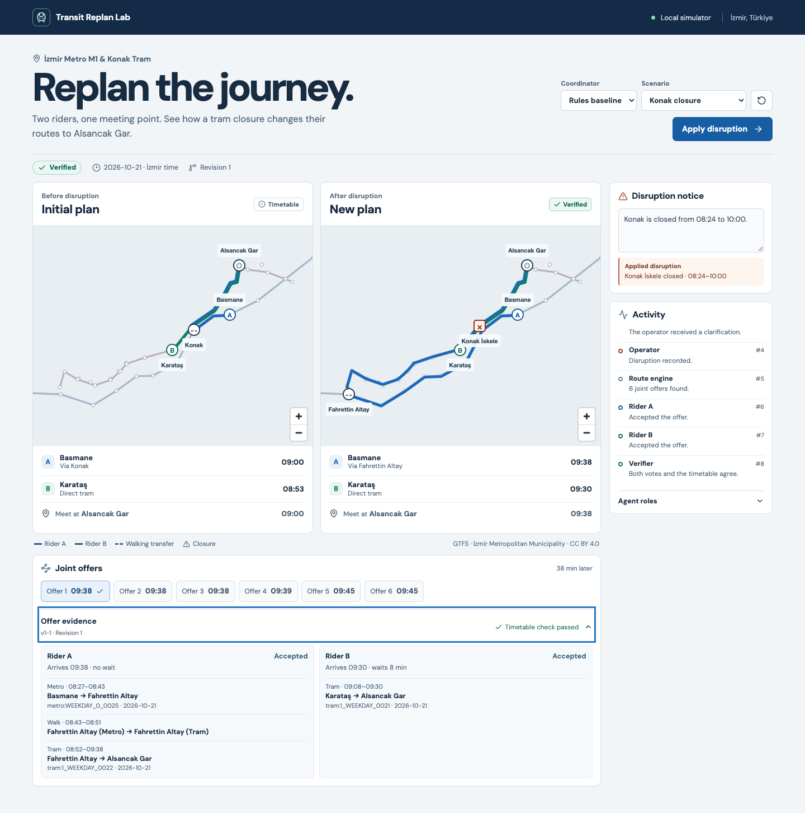

# Transit Replan Lab · v1 hardening review

**Review date** 2026-11-12 · **Baseline** `cf6414d` · **Scope** Simulator, browser and reproducibility tooling

## SWOT

| | Finding | Engineering response |
| --- | --- | --- |
| Strength | The archived timetable, versioned votes, independent verifier and recorded replay make the core demo reproducible. | Retain the existing release as a reference and test boundary failures against independent evidence. |
| Weakness | v1 grounds the incident target, while event type, timing and delay can come from an unsupported model prediction. The router also discards departure flexibility on a terminal walk. | Validate incident fields against the notice. Represent terminal walking windows and compare them with an exhaustive reference. |
| Opportunity | The UI already shows both plans. The selected offer can also explain who accepted it, how long each rider waits, and which scheduled legs the verifier checked. | Add an offer evidence panel and exercise it in the same end-to-end replay. |
| Threat | A dropped HTTP response can lose the client's command identity. Parallel snapshot requests can race, and resumed measurements can misstate the time or identity of an experimental condition. | Reuse the original command on transport failure, serialize the terminal snapshot, and record the experimental conditions that actually ran. |

## Findings and acceptance gates

| Priority | Finding | Acceptance gate |
| --- | --- | --- |
| P1 | The model can submit a valid stop ID with unsupported hours, or a valid trip with the wrong event or delay. Multiple named platforms can collapse to the longest name. | TR/EN notice and model-port regressions reject contradictory or missing evidence and preserve the seeded demo. |
| P1 | Earliest-only terminal walks can report an infeasible meeting when waiting upstream yields a joint arrival. | Compare bounded walk/ride networks with an independent exhaustive oracle, including closure boundaries and exact meeting windows. |
| P2 | A zero-leg itinerary can pass verification at an unknown stop. | Keep zero-leg itineraries at known stops and reject unknown endpoints. |
| P2 | Command retries allocate a fresh key and an older or failed snapshot can leave the browser showing the wrong state. | Playwright drops a response after commit, exercises a failed terminal read, and verifies one revision and current-revision evidence. |
| P2 | A resume can time an already completed run, and an Operator adapter can hide the base model digest in the evaluation rows. | Give each unrecorded attempt a fresh run, reject mixed conditions, and recover a torn final JSONL record without modifying completed rows. |
| P3 | Journey summaries imply that any route without a walk is a direct tram. Offers expose little of the verifier's evidence. | Show the scheduled legs, offer-specific votes, wait at the destination and the actual verification state. |

## Reproduced failures

- A typed Operator response changed a report's closure start from 08:24 to 08:30. The old coordinator verified a plan against the changed overlay. The regression now expects clarification and zero offers or votes. The same boundary covers a delay presented as cancellation, and a change from eight to twelve minutes. [Operator integration tests](../backend/tests/test_agents.py) · [Notice tests](../backend/tests/test_notice.py).
- In the small walking network, Rider B arrives at second 16. Rider A can wait upstream, walk for four seconds, arrive at second 14 and respect a two-second wait limit. The old search retained arrival at second 4 only. The routing test now checks the exact offer and the independent verifier's result. [Routing properties and regressions](../backend/tests/test_routing.py).
- An itinerary with no legs and an unknown shared stop passed independent verification. The verifier now requires registered endpoints even for a zero-leg journey. [Verifier](../backend/src/trl/verify.py).
- A browser transport interruption after commit left the client without a receipt. Playwright now drops that response and asserts that retry uses the original key, shows one revision, and renders one queued event. A separate fault drops the terminal read and confirms recovery without another POST. [Browser flows](../frontend/e2e/simulation.spec.ts).

## Delivery sequence

1. Add focused regressions, then harden incident intake and the independent verifier.
2. Correct terminal walking search and compare it with an exhaustive small-network oracle.
3. Make command retry and event-driven snapshot recovery deterministic. Connect the offer inspector to the exact revision shown on the map.
4. Harden the experiment runner. Run the development replay, the full local checks, desktop and mobile browser flows, and local Ollama smoke tests. Keep the v1 frozen datasets and published rows intact.

## Verified behavior

| Gate | Evidence |
| --- | --- |
| Route and offer invariants | The deterministic test suite passed 53 backend tests. Statement coverage for routing, verification, disruptions and storage was 96.70%. The two independent small-network properties have a combined budget of 250 generated examples. |
| Browser and deployment | Eight Chromium flows passed with the development servers and again against the Docker Compose deployment. The suite covers reconnect, lost creation and disruption receipts, a failed outcome read, clarification, stale evidence, the tight window, and mobile mediation. Each deployment mode writes traces to its own directory. |
| Local inference | Qwen3.5 4B on Ollama 0.40.16 verified both Konak replan attempts with seven calls per attempt. The tight meeting window returned infeasible after one call. Both feasible attempts produced the same sequence of public events. |
| Measurement recovery | A truncated replay record was removed on resume. The first four complete rows matched byte for byte, and the next case added four new rows. |
| Publication checks | Type checks, import contracts, frontend test, production build, and working-tree, staged and history boundary checks passed. The locked runtime dependency audits found no known advisories at the time of review. |

Run the deterministic and browser gates locally.

```sh
make check
make build
TRL_MODEL=replay make e2e
```

Inspect the selected offer after a clarification to see how the applied incident, route legs and two votes fit together.



The notice grammar covers explicit incidents for one target on the simulated service date. The router's optimality claim is bounded by the scenario window, configured transfer assumptions and search budgets. Browser recovery covers interrupted requests within the current tab. The API continues to expose persisted run history by run ID.

## Development evaluation

Qwen3.5 4B ran locally on an Apple M1 Pro with 16 GB using Ollama 0.40.16. The 24 development cases ran sequentially across four coordinators. Each returned 24/24 correct outcomes, including 14/14 feasible joint plans and 4/4 clarification cases. Across the 96 comparisons, zero verified offers failed the reference constraint check.

In the archived pre-grounding development run, the three model-backed coordinators each returned 20/24 correct outcomes. The four misses in each arm were the ambiguous notices. In this review run, the rules baseline reached p95 0.37 s and five agents reached p95 14.56 s. With equal outcome accuracy, the development results support the rules default. The v1.0.0 locked table describes its recorded revision.

[Generated report](../experiments/results/hardening-dev.md) · [Raw results](../experiments/results/hardening-dev.jsonl).
